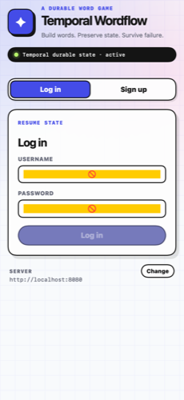
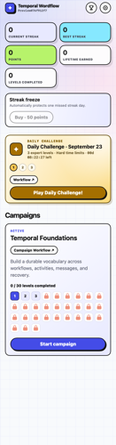
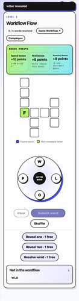

# Temporal Wordflow — iOS

A native SwiftUI port of the [Temporal Wordflow](../temporal-word-game) web game.
Same durable backend, same theme, native interaction.

The app owns nothing durable. Every campaign, level, guess, hint, point and
streak lives in a Temporal Workflow and is read back over the same REST API the
web client uses. The only local state is the session cookie, the shuffled letter
order on the wheel, and the letters currently under your finger.

## What it looks like

The theme is transcribed from `internal/api/web/styles.css`: ultraviolet
`#444CE7`, 2px ink borders, hard blur-free offset shadows, pastel statistic
tiles, the `✦` brand mark, the `LETTER QUEUE` dial, and the monospace `eyebrow`
kickers. Copy is taken verbatim from `index.html` and `app.js` — "Build words.
Preserve state. Survive failure.", "Not in the wordflow.", "Execution
succeeded.", and the rest.

| | | |
| --- | --- | --- |
|  |  |  |

<sub>Rendered from the real views by `Tools/preview.sh`, driving the live store
against a running Wordflow server — see [Verification](#verification).</sub>

### Native, not a web view

| Web | iOS |
| --- | --- |
| Click each letter, then press **Submit word** | **Swipe to connect** letters; lift to submit. A trail follows your finger, dragging back onto the previous letter un-picks the last one, and each new letter fires a selection haptic. Tapping still works — one tap arms a letter and waits, so you can mix the two. |
| `setInterval` tickers for every countdown | `TimelineView` for the speed-bonus, hard-limit and campaign countdowns; a single `Task` sleeps to the level deadline and then polls the level Workflow until it closes |
| Reload the page | Pull to refresh the campaign browser |
| Three fixed side panels | One scrolling column, with the bonus panel as a three-up row and the rejected-word history as wrapping chips |
| Both auth forms side by side | One segmented form, with the API's own username/display-name/password rules validated inline before a round trip |
| Toast `div` | The same black notice, with success/warning/error haptics behind it |
| Leaderboard page in a new tab | A sheet that polls every three seconds while it is on screen |
| `Workflow ↗` opens `/workflows/` in a new tab | The same page in an in-app web view, seeded with the session cookie so the explorer sees a signed-in player |

The `Workflow ↗` links are preserved. `/workflow-link` needs the session cookie
to resolve, and so does the `/workflows/` explorer it now redirects to, so the
app follows the `302` itself and opens the destination in a web view seeded from
`HTTPCookieStorage` rather than handing it to Safari signed out.

### Where it deliberately differs

Three places where the port does not copy the stylesheet literally, and why:

- **The bonus panel stays three-across.** Below 620px the stylesheet collapses
  it to one column; that would add roughly 90pt above the board and push the
  letter wheel off the first screen on every level. The three-up row is the
  stylesheet's own 621–1469px layout, so the design language is unchanged.
- **The auth screen shows one form at a time**, validated against the same
  rules `internal/api/auth.go` enforces, instead of two stacked cards that only
  report a problem on submit.
- **Settings has no web counterpart** — the browser build is served from its own
  API origin, so only iOS needs an editable server address.

## Requirements

- Xcode 16 or newer — built and tested here with Xcode 27 against the iOS 27
  simulator
- iOS 17 or newer (uses `@Observable` and the two-parameter `onChange`)

## Running it

Open `TemporalWordflow.xcodeproj` and run. It ships pointed at the hosted demo:

```
https://games.tmprl-demo.cloud
```

so there is nothing to start — sign up in the app and you are playing against
the deployed Workflows, alongside everyone else on that leaderboard.

To play against a server you are running yourself, start the backend from the
game repo and change the address under the gear:

```bash
cd ../temporal-word-game
make temporal   # terminal 1
make worker     # terminal 2
make server     # terminal 3 — serves the API on :8080
```

The simulator shares `localhost` with your Mac; on a physical device use your
Mac's LAN address (`http://192.168.1.20:8080`). `Info.plist` permits plain HTTP
only through `NSAllowsLocalNetworking`, so anything off-network has to be
HTTPS. The address is persisted, and `WORDFLOW_BASE_URL` in the scheme's launch
environment overrides it — which is how the UI tests keep off the demo host.

## Layout

```
TemporalWordflow/
  App/        TemporalWordflowApp.swift, RootView.swift   — scene, page chrome, notice toast
  Core/       APIClient, APIModels, AppStore, Formatters, GoTimestamp, Haptics, ServerSettings
  Design/     Theme (palette/type/metrics), Components, FlowLayout, PlatformCompat
  Features/   Auth, Catalog, Game, Complete, Leaderboard, Settings
  Resources/  Info.plist, Assets.xcassets (app icon rendered from web/favicon.svg)
Tools/        verification scripts — see below
```

`Core/` is pure Foundation. `AppStore` is a `@MainActor @Observable` transcription
of the state machine in `web/app.js`: the same phases, the same request order,
the same completion handshake (`/completion` polls until the Player Workflow has
cleared the active game), and the same brief poll after a hard time limit expires
while the level Workflow closes itself.

`Core/GoTimestamp.swift` exists because Go's `time.Time` omits fractional seconds
when they are zero and emits up to nine digits when they are not;
`ISO8601DateFormatter` needs a different option set for each shape and is not
`Sendable`, so the fixed RFC 3339 grammar is parsed directly.

## Verification

The project builds clean and runs on the simulator:

```bash
xcodebuild -project TemporalWordflow.xcodeproj -scheme TemporalWordflow \
  -destination 'platform=iOS Simulator,name=iPhone 17' build      # zero warnings
xcodebuild -project TemporalWordflow.xcodeproj -scheme TemporalWordflow \
  -destination 'platform=iOS Simulator,name=iPhone 17' test       # UI tests
```

`TemporalWordflowUITests` is the only place the drag recogniser on the letter
dial, real hit testing and the phase navigation are exercised for real. They
create players and complete levels, so they launch the app with
`WORDFLOW_BASE_URL` pointed at a local server rather than the hosted demo —
start one on `:8080` first (see below). Five cases:

| | |
| --- | --- |
| `testTappingOutAWordRecordsIt` | Taps F, L, O, W on the dial, submits, and asserts the web's own notice copy plus `1 / 4 words resolved` read back from durable state |
| `testSwipingTwoLettersSubmitsOnLift` | Traces two tokens in one continuous drag and asserts the word submits itself when the finger lifts |
| `testLeavingALevelKeepsItResumable` | Leaves a level and resumes it, which is the contract the Player Workflow keeps |
| `testSigningUpRequiresAMatchingConfirmation` | Covers the `passwordConfirmation` field the API started requiring |
| `testWorkflowLinkOpensTheExplorerSignedIn` | Opens `Workflow ↗` and asserts the explorer reports `Private view · <player>`, which only happens if the web view carried the session cookie |

Four of them register a throwaway player over HTTP and sign in through the
log-in form rather than the sign-up form, because iOS puts its "Use Strong
Password?" sheet over a `.newPassword` field the moment it takes focus, and a
"Save Password?" system alert over the app after a successful sign-in. Both are
ordinary AutoFill behaviour rather than app bugs, and the suite dismisses them.

Four more scripts run without a simulator, in seconds, and were how the app was
built before Xcode was available. They are still the fastest pre-flight:

```bash
./Tools/typecheck.sh             # compile + link the whole app, warnings as errors
./Tools/statetest.sh             # drive AppStore through a full play session, live
./Tools/smoketest.sh             # exercise APIClient + the Codable models, live
./Tools/preview.sh preview/      # screenshot every screen off-screen
python3 Tools/check-pbxproj.py   # validate the hand-written Xcode project
```

- **`typecheck.sh`** runs the real compiler over every source and links a
  binary, `@main` included — so it catches code generation, not just parsing.
  Every iOS-only API in the app sits behind a shim in
  `Design/PlatformCompat.swift`, which is what makes a macOS build possible. It
  pins `MacOSX26.5.sdk`: the newest CLT SDK ships SwiftUI's `@State` as a macro
  whose plugin only exists inside Xcode.
- **`statetest.sh`** compiles `Core/` for macOS and runs the real `AppStore`
  against a running server: sign up, load the catalog, start a level, trace and
  submit guesses, spend a hint, solve the level, read the completion handshake,
  continue to level 2, leave and resume, log out, log back in. 61 assertions.
- **`smoketest.sh`** checks the transport layer and the response models the same
  way, plus the timestamp parser and the countdown formatters. 81 assertions.
- **`preview.sh`** renders the shipping views with `ImageRenderer` at iPhone
  dimensions, driving the live store into each phase first — the sign-in form,
  the catalog, a level mid-play, a traced word on the wheel, the completion
  card, settings, the leaderboard and the daily-challenge strip. It also renders
  the widest board any campaign produces (15x11, Temporal Foundations level 25)
  at 320, 360 and 375pt, because that board is what the cell-size clamp has to
  survive. Setting
  `WORDFLOW_CAPTURE_TIMEOUT=1` also plays a daily level and waits out its
  three-minute hard limit to capture the timed-out solution board (so that run
  takes about four minutes). This is what `Design/PageScroll.swift` exists for:
  `ImageRenderer` renders a `ScrollView` as empty space, so every screen goes
  through one container that the snapshot path can swap for a plain stack.

Every live check creates throwaway players and completes levels, so point them
at a scratch namespace — never at the demo host, whose leaderboard is public:

```bash
cd ../temporal-word-game
temporal operator namespace create -n iostest
TEMPORAL_NAMESPACE=iostest go run ./cmd/worker
TEMPORAL_NAMESPACE=iostest SESSION_JWT_SECRET=local-temporal-wordflow-jwt-secret-change-before-deploying \
  go run ./cmd/server
# optional, for the daily-challenge strip and the hard-limit capture:
TEMPORAL_NAMESPACE=iostest go run ./cmd/campaign -file campaigns/daily-challenge-<today>.json
```

The UI tests use `http://localhost:8080`; the three Swift scripts take
`WORDFLOW_BASE_URL` and default to `http://localhost:8099`.

`Tools/make-appicon.swift` regenerates the app icon from the SVG path in
`web/favicon.svg` (`swift Tools/make-appicon.swift`).

All of it currently passes: a clean `xcodebuild … clean test` builds 30 sources
with zero warnings and runs all five UI cases green; `typecheck.sh`,
`statetest.sh` (61 assertions) and `smoketest.sh` (81) are green too.

## Still worth a human eye

- The letter-wheel gesture on glass: the hit slop is `0.62 × 48pt` with the
  travelled segment sampled every 8pt, which is right on paper and in the
  simulator but wants a thumb to confirm.
- Dynamic Type at the larger accessibility sizes, which the fixed-size neo-
  brutalist chips, pills and tiles will stress.
- Signing: `DEVELOPMENT_TEAM` is empty, so an archive build will ask for a team.
